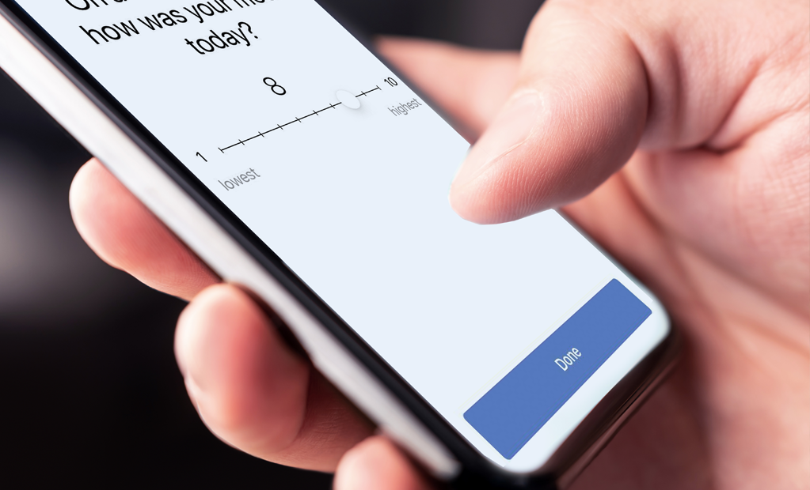

::: {.notes}
About a decade ago I was approaching the middle of my career.  I had developed a successful basic clinical science research program as a psychophysiologist running experiments to understand the effects of drugs and drug withdrawal on stress.  The work was intellectually stimulating, we were publishing it in good outlets, and we were getting grants, but my heart was increasingly not in it.  
:::

-----------------------------------------------------------------------------

::: {.notes}
I'd become a clinical psychologist to help people struggling with alcohol and other SUDs.  

- My paternal grandmother died of complications secondary to alcoholism. 

- My dad has struggled with his use of alcohol for his entire adult life and during periods where he lost control it affected all of us.

- My cousin, Stephen, has a severe substance use disorder and has been incarcerated several times for drug related offenses.  He has had periods of stability but they have always ended in another relapse.  

My Aunt Cathy and Stephen's brother, Colin, had reached out to me on numerous occasions to ask what could be done to help Stephen.  

And it was those conversations that really got me thinking about how I could re-direct my research program to help people like Stephen and my dad and my grandmother.  
:::

-----------------------------------------------------------------------------

## A Smart Recovery Monitoring and Support System

{.absolute bottom=0 right=50 width=30%}


::: {.notes}
It was around that time that Dave Gustafson reached out to me.  Dave directs a center on campus that develops digital therapeutics for substance use disorders.  These are essentially smartphone apps that provide ongoing continuing care for patients during their recovery.  He had just completed a large randomized controlled trial demonstrating that his app meaningfully decreased heavy drinking days and increased abstinence rates over the first year of recovery. 

However, he also noticed many of the people who had relapsed hadn't used the app in the days leading up to that relapse.  And others who had relapsed hadn't used the specific supports in the app that he would have thought would be most effective for them.
:::

-----------------------------------------------------------------------------

## A Smart Recovery Monitoring and Support System

\
\

> “Could you predict not only [who]{.uwred} might be at greatest risk for relapse … <br>
 … but precisely [when]{.uwred} that relapse might occur … <br>
 … and [how best to intervene]{.uwred} to prevent it?"
 
 \
 \
 
{.absolute bottom=0 right=50 width=30%}

::: {.notes}
Dave knew that we were exploring the factors that motivated alcohol and other drug use and he asked us a simple question: 

"Could you predict not only who might be at greatest risk for relapse but precisely when that relapse might occur and how best to intervene to prevent it"


... because if we could develop a system to do this, he could embed it into his app to guide people to the most effective supports at the most critical moments in their recovery.  
:::

-----------------------------------------------------------------------------

## A Smart Recovery Monitoring and Support System

- Precision mental health requires us to provide the [right interventions]{.uwred} and supports to the <br>[right people]{.uwred} at the [right time]{.uwred}, [every time]{.uwred}

\

- Continuing care for substance use disorders requires [long-term monitoring]{.uwred} and <br>[ongoing lifestyle adjustments and support]{.uwred} to prevent relapse

::: {.notes}
These questions that Dave was asking are at the heart of what we now call precision mental health.  How can we provide the **right interventions and supports** to the **right people** at the **right time**, **every time**

And this focus on the **right time** is particularly important for recovery from substance use disorders.  Substance use disorders are chronic relapsing conditions and therefore successful recovery requires lifelong monitoring and support to prevent relapse.  

And, critically, the optimal supports for any specific individual can change month to month, day to day, and even from moment to moment.
:::

-----------------------------------------------------------------------------

## A Smart Recovery Monitoring and Support System

- [Precision mental health requires us to provide the right treatments and supports to the <br>right people at the right time, every time]{.gray}

\

- [Continuing care for substance use disorders requires long-term monitoring and <br>ongoing lifestyle adjustments and support to prevent relapse]{.gray}

\

- A "Smart" Recovery Monitoring and Support System can provide temporally precise, dynamic, personalized continuing care by combining:
  - Sensing
  - Artificial Intelligence/Machine learning

::: {.notes}
We believed that we could harness and combine two technologies that were emerging at that time, 

personal sensing and artificial intelligence algorithms, 

to develop a smart recovery monitoring and support system that could both predict lapses before they occurred and provide personalized support and recommendations to patients about how to prevent those lapses from occurring.

And what I'd like to do today is tell you a bit more about how we are doing this, what we have learned so far, and where we are going next with this system.
:::

-----------------------------------------------------------------------------

## Personal Sensing

Personal sensing collects information from smartphones to identify a person's thoughts, feelings, behaviors, and context.

\

Sensing allows for "real-world" measurement that 

- can be sustained for long periods
- has very high temporal granularity 

::: {.notes}
First of all, lets talk briefly about the personal sensing inputs to our system.

Personal sensing is just a fancy term for methods that allow us to do real-world measurement of people's thoughts, feelings, behaviors, and context.  

These methods allow us to feasibly collect these inputs over very long periods of time from months to even years.

and we can collect these inputs with very high temporal granularity, at least several times per day and in some instances continuously
:::

-----------------------------------------------------------------------------

## Personal Sensing

[Personal sensing collects information from smartphones to identify a person's thoughts, feelings, behaviors, and context.]{.gray}

\

[Sensing allows for "real-world" measurement that]{.gray}

- [Can be sustained for long periods]{.gray}
- [Has very high temporal granularity]{.gray} 

\

We focus on 

- Ecological Momentary Assessment (EMA)
- Geolocation
- Smartphone communications (calls and texts)

::: {.notes}
At this point, we have worked extensively with a sensing method called ecological momentary assessment, or EMA for short, 

but I will also tell you about how we are expanding our sensing methods to include geolocation and smartphone communications data.
:::

-----------------------------------------------------------------------------

## Lapse Prediction for AUD

- 151 individuals with moderate to severe alcohol use disorder (AUD)

- Early in recovery (1-8 weeks)

- Committed to abstinence throughout study

- Followed with sensing for up to 3 months
  - Ecological Momentary Assessment (EMA)
  - Geolocation
  - Smartphone Communications

\

{.absolute bottom=0}

::: {.notes}
As the first step toward developing this system, in 2016 we were awarded a large grant from the NIAAA to recruit a sample of individuals in early recovery from moderate to severe AUD.

We followed these individuals for up to three months, using our three sensing methods and also recording any lapses back to alcohol use.
:::

-----------------------------------------------------------------------------

## Participant Characteristics

```{r}
#| label: figs_ema_demographics
#| fig-height: 6
#| fig-width: 10

source(here::here("figs/risk/figs_ema_demographics.R"))
cowplot::plot_grid(fig_age, fig_income, fig_sex_bar,
                   fig_educ_bar, fig_ms_bar, fig_race_bar, nrow = 2, ncol  = 3)
```

::: {.notes}
Let me start highlighting the characteristics of the sample we are using to develop and evaluate the AUD lapse models.

We had reasonble diversity across many participant charactersitics including age, sex at birth, martital status, education, and income

However, given the methods we used for recruiting, we have very little racial and ethinic diversity in the sample.  The sample is predominately white and non-hispanic

I'll return to this later both when we evaluate issues of algorithmic fairness and when I talk about another, larger NIDA funded project where we are correcting this issue of racial and ethnic representation in our models.  
:::

-----------------------------------------------------------------------------

## Participant Characteristics

::: {.columns}
:::: {.column width="50%"}

\

- All participants met criteria for moderate to severe AUD

\

- Reported abstinence goals
::::

:::: {.column width="50%"}
```{r}
#| label: figs_sx
#| fig-height: 6
#| fig-width: 6 

# plot made in fig_demographics.R
fig_sx
```
::::
:::

::: {.notes}
I also want to highlight that this is a sample with clinically meaningful problems with their AUD use, consistent with their pursuit of abstinence goals

On the right, I am showing you a histogram of the DSM-5 AUD symptom counts to confirm that everyone reported 4 or more symptoms of alcohol use disorder consistent with a moderate to severe presentation
:::

-----------------------------------------------------------------------------

## Ecological Momentary Assessment (EMA)

- Current/Recent Experiences
  - Craving
  - Affect
  - Recent past alcohol use
  - Recent risky situations
  - Recent stressful events
  - Recent pleasant event

\

- Future Expectations
  - Risky situations
  - Stressful events
  - Abstinence Confidence

{.absolute bottom=0 right=50 width=45%}

::: {.notes}
The first machine learning prediction models we developed used features from EMAs so let me tell you a bit more about this method.

These EMAs are brief surveys that participants completed on their smartphones.  They take 20-30 seconds to complete and we collected them several times per day.

Participants used these EMAs to report on their current experiences including their craving, affect, and recent alcohol use.  And they also let us know about future expected important events in the coming week and their confidence that they could remain abstinent.
:::

-----------------------------------------------------------------------------

## Model Predictions 

- Predict hour-by-hour probability of [future lapse]{.uwred}

\

- Lapse window widths
  - Next week 
  - Next day
  - Next hour 

::: {.notes}
We used features from these EMAs to train machine learning models that make predictions about the hour-by-hour probability of a future lapse.  

And we developed separate models for three future lapse windows – lapses in the next week, lapses in the next day, and lapses in the next hour.  
:::

-----------------------------------------------------------------------------

## Model Predictions 

- Predict hour-by-hour probability of [future lapse]{.uwred}

\

- Lapse window widths
  - Next week 
  - Next day
  - Next hour 

::: {.notes}
For example, if I was in recovery, I could use these models to generate the probability that I would lapse after this symposium ends. The next week model would generate the probability I would lapse at some point between 1 pm today and 1 pm next Friday, the next day model would predict the probability that I would lapse between 1 pm today and 1 pm tomorrow and the most temporally precise next hour model would provide the probability that I would lapse between 1pm today and 2pm today.  

And of course, all of the models would only use data collected prior to 1 pm today so that they are “predicting”, in the full sense of the word, into the future and not just demonstrating an association.
:::

-----------------------------------------------------------------------------

## Model Performance

The Area under the Receiver Operating Characteristic Curve (auROC) indicates the probability that any true lapse is scored higher than any true no-lapse by the model

- Random performance:  auROC = 0.5 
- Perfect performance: auROC = 1.0 


:::::: {.callout-corner}
:::::{.callout-tip icon=false}
## Rules of thumb for auROC 
.70 - .80 is considered fair  
.80 - .90 is considered good  
\>= .90 is considered excellent  
:::::
::::::

::: {.notes}
We can evaluate the performance accuracy of these models using a metric called the auROC for short.  

- An auROC of .5 indicates a model whose accuracy is no better than random guessing, and 
- An auROC of 1.0 indicates perfect accuracy

And models with auROCs of .90 or higher are considered to have excellent performance.
:::

-----------------------------------------------------------------------------

## Model Performance

::: {.columns}
:::: {.column width="40%" .callout-corner}

:::::{.callout-tip icon=false}
## Rules of thumb for auROC 
.70 - .80 is considered fair  
.80 - .90 is considered good  
\>= .90 is considered excellent  
:::::

::::

:::: {.column width="60%"}
```{r}
#| label: figs_auroc_ci_1
#| fig-height: 6
#| fig-width: 6

source(here::here("figs/risk/figs_ema_probability.R"))
fig_auroc_ci_1
```
::::
:::

::: {.notes}
[PAUSE]

So given this, we were very encouraged to see that our one week prediction model had excellent performance with an auROC of approximately .90.
:::

-----------------------------------------------------------------------------

## Model Performance

::: {.columns}
:::: {.column width="40%" .callout-corner}
:::::{.callout-tip icon=false}
## Rules of thumb for auROC 
.70 - .80 is considered fair  
.80 - .90 is considered good  
\>= .90 is considered excellent  
:::::
::::

:::: {.column width="60%"}
```{r}
#| label: figs_auroc_ci_2
#| fig-height: 6
#| fig-width: 6

fig_auroc_ci_2
```
::::
:::

::: {.notes}
And our model that made predictions about the lapse probability in the next day performed even better. 

[PAUSE]
:::

-----------------------------------------------------------------------------

## Model Performance: Excellent auROCs

::: {.columns}
:::: {.column width="40%" .callout-corner}
:::::{.callout-tip icon=false}
## Rules of thumb for auROC 
.70 - .80 is considered fair  
.80 - .90 is considered good  
\>= .90 is considered excellent  
:::::
::::

:::: {.column width="60%"}
```{r}
#| label: figs_auroc_ci_3
#| fig-height: 6
#| fig-width: 6

fig_auroc_ci_3
```
::::
:::

::: {.notes}
and our one hour model had the highest performance of all with an auROC of 0.93. 

Candidly, we hadn't anticipated that we could do this well with such high levels of temporal precision.  

But we can, and to be clear, we believe all three of these models to have clinically implementable levels of performance such that we can use them to make meaningful decisions for individual participants at specific moments in time.
:::

-----------------------------------------------------------------------------

## Model Calibration: Trusting the Probabilities 

::: {.columns}
:::: {.column width="45%"}

\

- Probabilities are well calibrated where most predictions fall
- Ordinal across the full range
- Provides fine gradations of relative risk for clinical decision-making
::::

:::: {.column width="55%"}
```{r}
#| label: aud_calibration_plot
#| fig-height: 6
#| fig-width: 6

fig_cal
```
::::
:::

::: {.notes}
[COMMENT - REVIEW WHEN FINE-TUNING NOTES: This may be the place to discuss our plans to provide feedback to patients in the form of their level of risk or recovery health, rather than formally predicting lapse vs. no lapse.]

Beyond discriminating well between lapses and non-lapses, we also want to be able to trust the lapse probabilities themselves.

On the right, I am showing you a simple calibration plot for our next day model. On the x-axis, I've binned predicted lapse probabilities into bins that are 10 percent wide, and for each bin, I display the actual observed probability of lapses for observations in that bin.

If the probabilities were perfectly calibrated, the bin means would all fall on the dotted line, with the bin from 0 - .1 having an observed probability of about .05, the bin from .1 - .2 having a probability of about .15, and so on.

Calibration is excellent at the low end, where the large majority of predictions fall. In the middle of the range, the model somewhat overestimates risk. But across the full range, higher predicted probabilities always mean higher observed lapse rates.

Given this, we believe that the lapse probabilities can provide fine gradations of relative risk for clinical decision-making.
:::

-----------------------------------------------------------------------------

## Lagged Prediction: Advanced Warning

::: {.columns}
:::: {.column width="50%"}
- Previous models only predict immediate future 
- Advanced warning needed for some types of supports 
::::

:::: {.column width="50%"}

<!--Blank-->

::::
:::

::: {.notes}

[PAUSE]

Now, you might have noticed that up until this point, I've only talked about predictions for the immediate future - the next week, the next day, or the next hour.  And in these past few examples, I've been talking about using one of those immediate models - the next day model - to provide personalized support recommendations that the patient can implement that next day.

However, for some types of support, people may need some advanced warning to put those supports into place.   For example, if you need to meet with your AA sponsor or get in to see your therapist, you will need some lead time to schedule those meetings or appointments.   
:::

-----------------------------------------------------------------------------

## Lagged Prediction: Advanced Warning

::: {.columns}
:::: {.column width="50%"}
- [Previous models only predict immediate future]{.gray}
- [Advanced warning needed for some types of supports]{.gray} 

\

- Can lag model up to two weeks into the future
- Performance drops but still remains good
::::

:::: {.column width="50%"}
```{r}
#| label: figs_lag_ci
#| fig-height: 6
#| fig-width: 6

source(here::here("figs/risk/figs_lag_ci.R"))
fig_lag_ci
```
::::
:::

::: {.notes}
Given this, we have begun to explore various methods for predicting lapse probabilities further into the future.  

As a first step, we took the model which predicted lapses in the next week and lagged it by different periods from one day up to two weeks into the future.   For example, the two week lagged model predicts the probability of a lapse that will occur during a one week period but that period begins two weeks from now.  

And as you can see from the plot on the right, this approach does result in a drop in performance as we move further into the future.  But even with a two week lag, we still have an auROC of .85 which is still potentially clinically useful.

And we are currently exploring other methods for predicting lapse probabilities further into the future that may perform better than this simple lagging approach and I'd be happy to talk more about those during the discussion period if anyone is interested.
:::

-----------------------------------------------------------------------------


## Passive Sensing Methods: Geolocation 

::: {.notes}

FIX TRANSITION AND FOCUS ON GPS.

[PAUSE]

Next up.... as our monitoring and support system continues to mature, we will want a richer, broader set of lapse risk features so that we can distinguish better between different situations that require different supports. 

We can do this by engineering features from our location and communication signals, which tap into different experiences than what we measure by EMA.
:::

-----------------------------------------------------------------------------

## {#gps_detection_1 data-menu-title="GPS detection, wide view" background-image="https://dionysus.psych.wisc.edu/present/john_gps_wide.png" background-size="100%" background-position="bottom" background-repeat="none"}


::: {.notes}
To give you taste of the power for these novel signals, here is a wide view of my moment-by-moment location detected by a GPS app over a month when we were first experimenting with this sensing method.  The app recorded the paths that I traveled, with movement by car in green and running in blue.

The red dots indicate places that I stopped to visit for at least a few minutes.

And although not displayed here, the app recorded the days and exact times that I was at each of these locations.

From these data, you can immediately see that I am runner, with long runs leaving from downtown Madison and frequent trail runs on the weekends in the county and state parks to the west and northwest.
:::

-----------------------------------------------------------------------------

## {#gps_detection_2 data-menu-title="GPS detection, zoomed" background-image="https://dionysus.psych.wisc.edu/present/john_gps_zoom.png" background-size="100%" background-position="bottom" background-repeat="none"}


::: {.notes}
Zooming in to the Madison isthmus, these data show that I drove my children halfway around the lake each morning to their elementary school.  And from these data we might be able to detect those stressful mornings when getting my young kids dressed and fed didn't go as planned and we were late, sometimes **very late**, to school!

The app recorded my daily running commute through downtown Madison to and from my office.  From this, we can observe my longs days at the office and also those days that I skipped out.

Looking at the red dots indicating the places I visit, the system can detect the restaurants, bars, and coffee shops where I eat, drink and socialize.  We can use public map data to identify these places and make inferences about what I do there.

[PAUSE]

Both geolocation and communications data are powerful sensed signals that we have already begun to use to predict lapse risk with success.

And we plan to implement a model with both EMA and geolocation for a new project that we are just launching now.
:::

-----------------------------------------------------------------------------

## Passive Sensing Methods: Geolocation 

SLIDES ON AUD GPS MODEL.   JUST PERFORMANCE FOR NOW.

Make clear that it doesn't add much to EMA RE prediction but gives more features for personalization

-----------------------------------------------------------------------------

## Algorithmic Fairness

::: {.notes}

FIX THIS TRANSITION


So, obviously, we are really excited about the potential capabilities of this system for providing personalized continuing care.  

But not surprisingly, there are still a number of very important issues to address before we can implement this system.
:::

-----------------------------------------------------------------------------

## Algorithmic Fairness

::: {.notes}
To start, our models have some serious but unfortunately not unexpected problems given what I told you earlier about the some of the demographic limitations of our training data.  

I've already shown you that our models perform exceptionally well when evaluated across the full sample.  However, when we evaluate model performance, it is critical that we look at performance in subgroups that experience health disparities.  And too often, these analyses are not done or reported.  

Its only very recently that we have begin to take this seriously and we must.  If we hope to use our system to address existing disparities in SUD outcomes then our models must perform well with all groups, regardless of their privilege or the use of these models may exacerbate rather than reduce existing mental healthcare disparities.
:::

-----------------------------------------------------------------------------

## Algorithmic Fairness

::: {.columns}
:::: {.column width="50%"}
```{r}
#| label: fig_race_1
#| fig-height: 6
#| fig-width: 8

fig_race_bar
```
::::

:::: {.column width="50%"}
<!--BLANK-->
::::
:::

::: {.notes}
As one example of this issue, the data we collected to train these models from this first NIAAA grant did not include much racial or ethnic diversity among the participants.   We collected those data at a time when we weren't yet thinking as carefully about issues of representation as we try to do now.
:::

-----------------------------------------------------------------------------

## Algorithmic Fairness

::: {.columns}
:::: {.column width="50%"}
```{r}
#| label: fig_race_2
#| fig-height: 6
#| fig-width: 8

fig_race_bar
```
::::

:::: {.column width="50%"}
```{r}
#| label: figs_fair_race
#| fig-height: 6
#| fig-width: 8

source(here::here("figs/risk/figs_fairema_ci.R"))
fig_fair_race_1
```
::::
:::

::: {.notes}
Given that, we were dismayed but not surprised to find that those models perform substantially worse (with auROCs that are .19 units lower) when predicting lapses for anyone who wasn’t white and non-hispanic.
:::

-------------------------------------------------------------------------------

## Algorithmic Fairness

```{r}
#| label: figs_fairema_ci-2
#| fig-height: 6
#| fig-width: 10 

cowplot::plot_grid(fig_fair_race_1, fig_fair_income_1, fig_fair_sex_1,
                   nrow = 1, align = "h")
```

::: {.notes}
And these fairness issues were not limited to just race and ethnicity.  We see worse performance for participants with incomes below the poverty line and to a lessor extent for female participants. 

This is obviously unacceptable and we are working now to correct this.
:::

-----------------------------------------------------------------------------
 
## Algorithmic Fairness: NIDA Opioid Use Lapses 

- 296 patients in recovery from Opioid Use Disorder, all on MOUD 
- [National sample: 47 states; diverse demographics and locations]{.uwred}
- 1 – 12 months on MOUD at start
- 1 daily survey plus geolocation sensing for up to 12 months

\

{.absolute bottom=0}

::: {.notes}
For example, with a grant from NIDA, we set out to collect a more diverse sample using nationwide recruiting.

We followed 296 people in recovery from opioid use disorder who were all receiving medications for opioid use disorder, or MOUD, like buprenorphine or methadone.  They came from 47 states, which gave us much needed geographic diversity as well, because the factors that predict lapse in urban settings may be different from those that predict lapse in rural settings.

We also enrolled people across a wider range of time in recovery - anywhere from 1 to 12 months on MOUD when they started.

And we made the monitoring much lighter.  Participants completed just one brief survey each day, and we added geolocation sensing that ran passively on their phones.  And we followed them for up to a full year - on average, people stayed on study for more than 9 months.
:::

-----------------------------------------------------------------------------

## Algorithmic Fairness: NIDA Opioid Use Lapses 

::: {.columns}
:::: {.column width="40%"}

\

- Excellent performance: auROC ~ 0.94
::::

:::: {.column width="60%"}
```{r}
#| label: figs_auroc_ci_oud
#| fig-height: 6
#| fig-width: 6

source(here::here("figs/risk2/figs_perf_ci.R"))
fig_auroc_ci_oud
```
::::
:::

::: {.notes}

[PAUSE]

So how well did we do in this new sample?

Here is the same performance figure I showed you earlier for our three alcohol models, and I've added our next day model for opioid lapses on the far right.

This model has an auROC of .94.  That is better than our next day alcohol model, and as good as or better than even our next hour alcohol model.

And we got this level of performance with much less burden on participants.  In this study, people completed only one brief survey per day, rather than four.  We did add geolocation sensing, but that runs passively in the background on their phone and asks nothing of them.

Of course, this is a different study, with a different substance and a different sample, so this isn't a head-to-head comparison.  But it tells us that we can get excellent lapse prediction with a much lighter touch - which matters a lot if we want people to stick with a system like this for months or years.
:::

-----------------------------------------------------------------------------

## Algorithmic Fairness: NIDA Opioid Use Lapses 


- [Excellent performance: auROC ~ 0.94]{.gray}

```{r}
#| label: figs_fair_risk2_ci_1
#| fig-height: 6
#| fig-width: 12 

source(here::here("figs/risk2/figs_fair_ci.R"))
cowplot::plot_grid(fig_fair_race_2, fig_fair_income_2, fig_fair_sex_2,
                   fig_fair_geo_2, nrow = 1, align = "h")
```

::: {.notes}
And more importantly, this next day prediction model is much fairer.  The large performance gaps we saw in our original models for race and ethnicity, income, and sex have mostly closed.  And we can now also look at people living in rural vs. urban areas.

To be clear, the gaps are not zero.  The model still performs slightly worse for most of the less advantaged groups - by about one to two hundredths of a point in auROC - and with this much data, those small differences are reliable.  Interestingly, for income, the model actually performs slightly better for people with lower incomes.

But what matters most clinically is that performance is excellent for everyone.  Every group has an auROC between .92 and .95, which is better than our original AUD models achieved even for the groups they served best.

[PAUSE]

But let me explicitly say that issues related to fairness and the potential to exacerbate health disparities through the use of a sensing and AI based monitoring and support system are much more complicated than what I've had time to present here. 

I’d be happy to dive a bit deeper into this during the discussion period if people are interested to engage more with this.
:::


-----------------------------------------------------------------------------

## Feature Importance:  Looking Under the Hood

AUD GLOBAL SHAPS

-----------------------------------------------------------------------------

## Feature Importance:  Looking Under the Hood

OUD GLOBAL SHAPS

-----------------------------------------------------------------------------

## Feature Importance:  Looking Under the Hood

OUD Daily most important features. 

-----------------------------------------------------------------------------

## Beyond Prediction: Personalized Recommendations 

::: columns
::: {.column width="50%"}
```{r}
#| fig-height: 3
#| fig-width: 5

source(here::here("figs/opt/figs_opt_shaps.R"))
fig_shap_ex1
```
:::

::: {.column width="50%"}
<!--Blank-->
:::
:::

::: columns
::: {.column width="50%"}
<!-- Blank-->
:::

::: {.column width="50%"}
<!-- Blank-->
:::
:::

::: {.notes}

WORK ON TRANSITION


But we can get much more than just lapse probabilities from these models. 

Using SHAP values, we can understand which features contributed most strongly to any prediction for a specific person at a specific moment in time.  This allows us to understand not only WHEN a lapse might occur but also WHY and potentially how best to intervene. 

For example, in this first plot,  I am showing you someone who would be predicted to have a high lapse probability on day 30 of their recovery because they have been reporting high craving.  For that person, we could recommend urge surfing techniques or remind them that distracting activities can help get them through short periods of craving.
:::

-----------------------------------------------------------------------------

## Beyond Prediction: Personalized Recommendations 

::: columns
::: {.column width="50%"}
```{r}
#| fig-height: 3
#| fig-width: 5

fig_shap_ex1
```
:::

::: {.column width="50%"}
<!--blank-->
:::
:::

::: columns
::: {.column width="50%"}
```{r}
#| fig-height: 3
#| fig-width: 5

fig_shap_ex2
```
:::

::: {.column width="50%"}
<!--Blank-->
:::
:::

::: {.notes}
In contrast, a second person might have similarly high lapse probability on day 30 of their recovery, but instead because they have lapsed a few times in recent weeks. They could be encouraged and assisted to complete activities designed to increase their motivation for abstinence. 
:::

-----------------------------------------------------------------------------

## Beyond Prediction: Personalized Recommendations 

::: columns
::: {.column width="50%"}
```{r}
#| fig-height: 3
#| fig-width: 5

fig_shap_ex1
```
:::

::: {.column width="50%"}
<!--Blank-->
:::
:::

::: columns
::: {.column width="50%"}
```{r}
#| fig-height: 3
#| fig-width: 5

fig_shap_ex2
```
:::

::: {.column width="50%"}
```{r}
#| fig-height: 3
#| fig-width: 5

fig_shap_ex3
```
:::
:::

::: {.notes}
And at a later point in time, that same person may have improved their abstinence motivation but now be at increased risk for a lapse because of a string of recent past and anticipated stressors.   

Now they could be provided with guided stress reduction or relaxation techniques that they could use each day.  

In this way, we can provide personalized recommendations to patients that are tailored to their unique risk profile at that moment in time.
:::

-----------------------------------------------------------------------------

## Next Steps: A Smart Digital Health (Therapeutic) App

introduce the idea of a DTx (Insights app) that has native prediction


Introduce the core engagement loop from Insights app?

-----------------------------------------------------------------------------

## Next Steps: Optimize System Feedback to Patients 

- Sensing EMA and geolocation for six months
- Model updated each night (4 am) for next day
  - Lapse probability prediction
  - Recent trend in lapse probability
  - Important risk features
  - Risk relevant support recommendation
  
- Participants receive daily messages varying combinations of these components

- Measure trust, utility, engagement, and clinical outcomes

Data collection begins in ~ 1 month

{.absolute bottom=0}

::: {.notes}
And that brings us to perhaps the most important next step.

Just because our prediction models perform well, doesn't guarantee that they will provide meaningful clinical benefits.

We need to be able to provide feedback from these models to patients such that they trust the system, find it useful, and engage with it over time in a way that improves their recovery.

And we were just awarded another grant from the NIAAA to do exactly this.  

In this project, we will be using a model with inputs from both EMA and geolocation.  We will use the model to make 

- daily lapse probability predictions, 
- identify current personalized lapse risks, 
- and map those risks to behavioral and support recommendations that are specific to each person each day.   

We can then manipulate what information we include in daily messages from the system to participants to increase their trust and engagement with the system as well as formally evaluating its clinical benefits.

Obviously, we are very excited to get started on this project because it will bring us one step closer to providing meaningful support to individuals in recovery.   

Thanks for your time, and I'd be happy to answer any questions you might have now or later at the end of this session.
:::
