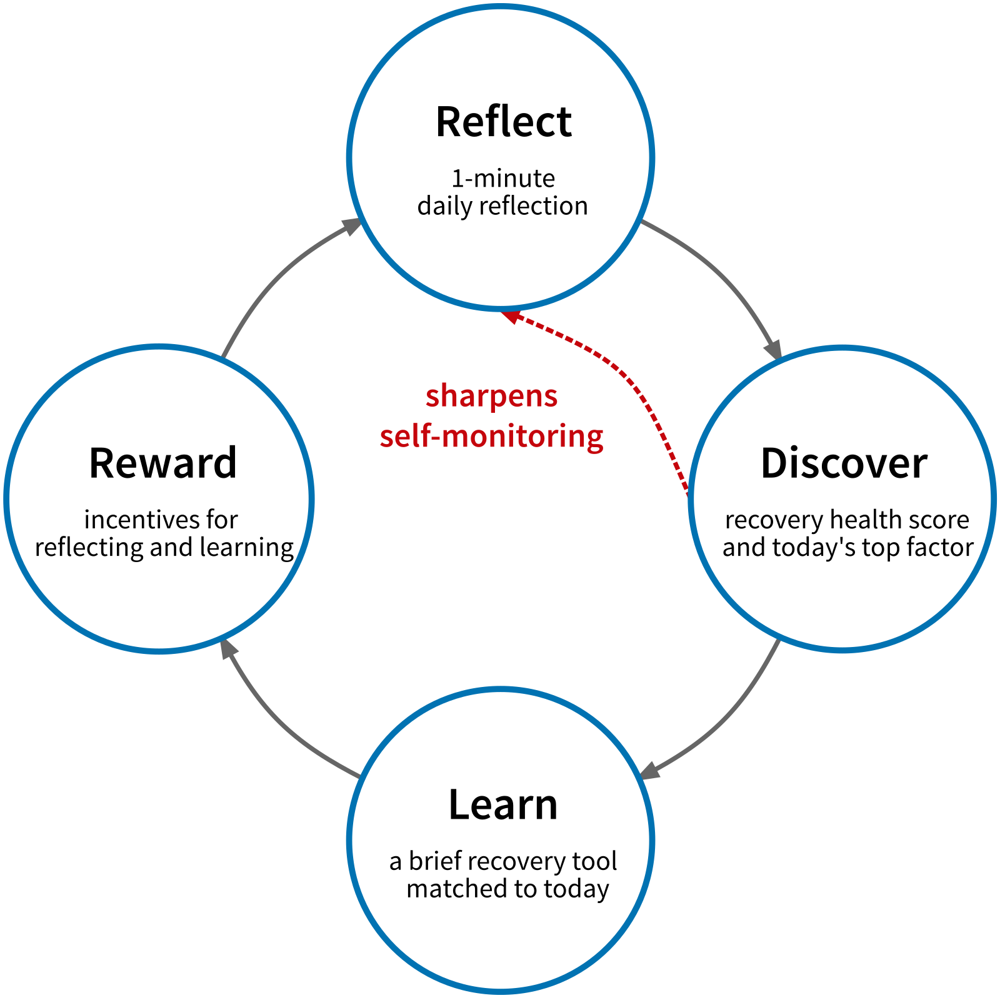

## Disclosures

- [Claire Punturieri]{.uwred}, [Kendra Wyant]{.uwred} (graduate students) and I developed machine learning models that predict substance use lapses and identify risk factors in real time

\

- The [Wisconsin Alumni Research Foundation (WARF)]{.uwred} holds the copyright and manages this IP to help UW inventions reach the public

\

- [Rudra Health AI]{.uwred} has licensed these models and is developing a digital health app to support recovery

\

- I am a co-founder and Chief Science Officer of Rudra Health AI

::: {.notes}
[DRAFT]

Before I start, I need to make a disclosure, and it also gives you a preview of where this talk is going.

Two of my graduate students, Claire Punturieri and Kendra Wyant, have developed machine learning models that predict substance use lapses and identify the risk factors driving them, in real time.  You'll see a lot of their work today.

The Wisconsin Alumni Research Foundation, or WARF, holds the copyright on these models.  WARF is a non-profit that helps UW scientists turn their inventions into products, so that the work can have a broader impact on public health.

WARF has licensed these models to Rudra Health AI, which is developing a digital health app to support people in recovery.  I am a co-founder and the Chief Science Officer of Rudra Health AI, so I have a financial interest in this work.  I'll come back to the app near the end of the talk.
:::

-----------------------------------------------------------------------------

::: {.notes}
About a decade ago I was approaching the middle of my career.  I had developed a successful basic clinical science research program as a psychophysiologist running experiments to understand the effects of drugs and drug withdrawal on stress.  The work was intellectually stimulating, we were publishing it in good outlets, and we were getting grants, but my heart was increasingly not in it.  
:::

-----------------------------------------------------------------------------

::: {.notes}
I'd become a clinical psychologist to help people struggling with alcohol and other SUDs.  

- My paternal grandmother died of complications secondary to alcoholism. 

- My dad has struggled with his use of alcohol for his entire adult life and during periods where he lost control it affected all of us.

- My cousin, Stephen, has a severe substance use disorder and has been incarcerated several times for drug related offenses.  He has had periods of stability but they have always ended in another relapse.  

My Aunt Cathy and Stephen's brother, Colin, had reached out to me on numerous occasions to ask what could be done to help Stephen.  

And it was those conversations that really got me thinking about how I could re-direct my research program to help people like Stephen and my dad and my grandmother.  
:::

-----------------------------------------------------------------------------

## A Smart Recovery Monitoring and Support System

{.absolute bottom=0 right=50 width=30%}


::: {.notes}
It was around that time that Dave Gustafson reached out to me.  Dave directs a center on campus that develops digital health apps for substance use disorders.  These are essentially smartphone apps that provide ongoing continuing care for patients during their recovery.  He had just completed a large randomized controlled trial demonstrating that his app meaningfully decreased heavy drinking days and increased abstinence rates over the first year of recovery. 

However, he also noticed many of the people who had relapsed hadn't used the app in the days leading up to that relapse.  And others who had relapsed hadn't used the specific supports in the app that he would have thought would be most effective for them.
:::

-----------------------------------------------------------------------------

## A Smart Recovery Monitoring and Support System

\
\

> “Could you predict not only [who]{.uwred} might be at greatest risk for relapse … <br>
 … but precisely [when]{.uwred} that relapse might occur … <br>
 … and [how best to intervene]{.uwred} to prevent it?"
 
 \
 \
 
{.absolute bottom=0 right=50 width=30%}

::: {.notes}
Dave knew that we were exploring the factors that motivated alcohol and other drug use and he asked us a simple question: 

"Could you predict not only who might be at greatest risk for relapse but precisely when that relapse might occur and how best to intervene to prevent it"


... because if we could develop a system to do this, he could embed it into his app to guide people to the most effective supports at the most critical moments in their recovery.  
:::

-----------------------------------------------------------------------------

## A Smart Recovery Monitoring and Support System

- Precision mental health requires us to provide the [right interventions]{.uwred} and supports to the <br>[right people]{.uwred} at the [right time]{.uwred}, [every time]{.uwred}

\

- Continuing care for substance use disorders requires [long-term monitoring]{.uwred} and <br>[ongoing lifestyle adjustments and support]{.uwred} to prevent relapse

::: {.notes}
These questions that Dave was asking are at the heart of what we now call precision mental health.  How can we provide the **right interventions and supports** to the **right people** at the **right time**, **every time**

And this focus on the **right time** is particularly important for recovery from substance use disorders.  Substance use disorders are chronic relapsing conditions and therefore successful recovery requires lifelong monitoring and support to prevent relapse.  

And, critically, the optimal supports for any specific individual can change month to month, day to day, and even from moment to moment.
:::

-----------------------------------------------------------------------------

## A Smart Recovery Monitoring and Support System

- [Precision mental health requires us to provide the right treatments and supports to the <br>right people at the right time, every time]{.gray}

\

- [Continuing care for substance use disorders requires long-term monitoring and <br>ongoing lifestyle adjustments and support to prevent relapse]{.gray}

\

- A "Smart" Recovery Monitoring and Support System can provide temporally precise, dynamic, personalized continuing care by combining:
  - Sensing
  - Artificial Intelligence/Machine learning

::: {.notes}
We believed that we could harness and combine two technologies that were emerging at that time, 

personal sensing and artificial intelligence algorithms, 

to develop a smart recovery monitoring and support system that could both predict lapses before they occurred and provide personalized support and recommendations to patients about how to prevent those lapses from occurring.

And what I'd like to do today is tell you a bit more about how we are doing this, what we have learned so far, and where we are going next with this system.
:::

-----------------------------------------------------------------------------

## Personal Sensing

Personal sensing collects information from smartphones to identify a person's thoughts, feelings, behaviors, and context.

\

Sensing allows for "real-world" measurement that 

- can be sustained for long periods
- has very high temporal granularity 

::: {.notes}
First of all, lets talk briefly about the personal sensing inputs to our system.

Personal sensing is just a fancy term for methods that allow us to do real-world measurement of people's thoughts, feelings, behaviors, and context.  

These methods allow us to feasibly collect these inputs over very long periods of time from months to even years.

and we can collect these inputs with very high temporal granularity, at least several times per day and in some instances continuously
:::

-----------------------------------------------------------------------------

## Personal Sensing

[Personal sensing collects information from smartphones to identify a person's thoughts, feelings, behaviors, and context.]{.gray}

\

[Sensing allows for "real-world" measurement that]{.gray}

- [Can be sustained for long periods]{.gray}
- [Has very high temporal granularity]{.gray} 

\

We focus on 

- Brief daily surveys 
- Geolocation
- (smartphone communications (calls and texts), audio/video check-ins, sleep)

::: {.notes}
At this point, we have worked extensively with ecological momentary assessments and other brief survey methods and geolocation sensing as our two primary buckets of inputs.  We do sense other inputs as well but in the service of time I will leave those to the question period if people are interested. 
:::

-----------------------------------------------------------------------------

## Lapse Prediction for AUD


- 151 individuals with moderate to severe alcohol use disorder (AUD)

- Early in recovery (1-8 weeks)

- Committed to abstinence throughout study

- Followed with sensing for up to 3 months
  - Brief surveys (4x daily) 
  - Geolocation
  - (other sensing methods)

\

{.absolute bottom=0}

::: {.notes}
As the first step toward developing this system, in 2016 we were awarded a large grant from the NIAAA to recruit a sample of individuals in early recovery from moderate to severe AUD.

We followed these individuals for up to three months, using our focal sensing methods and also recording any lapses back to alcohol use.
:::

-----------------------------------------------------------------------------

## Participant Characteristics

```{r}
#| label: figs_ema_demographics
#| fig-height: 6
#| fig-width: 10

source(here::here("figs/risk/figs_ema_demographics.R"))
cowplot::plot_grid(fig_age, fig_income, fig_sex_bar,
                   fig_educ_bar, fig_ms_bar, fig_race_bar_demo, nrow = 2, ncol  = 3)
```

::: {.notes}
Let me start highlighting the characteristics of the sample we are using to develop and evaluate the AUD lapse models.

We had reasonable diversity across many participant characteristics including age, sex at birth, marital status, education, and income

However, given the methods we used for recruiting, we have very little racial and ethinic diversity in the sample.  The sample is predominately white and non-hispanic

I'll return to this later both when we evaluate issues of algorithmic fairness and when I talk about another, larger NIDA funded project where we are correcting this issue of racial and ethnic representation in our models.  
:::

-----------------------------------------------------------------------------

## Participant Characteristics

::: {.columns}
:::: {.column width="50%"}

\

- All participants met criteria for moderate to severe AUD

\

- Reported abstinence goals
::::

:::: {.column width="50%"}
```{r}
#| label: figs_sx
#| fig-height: 6
#| fig-width: 6 

# plot made in fig_demographics.R
fig_sx
```
::::
:::

::: {.notes}
I also want to highlight that this is a sample with clinically meaningful problems with their AUD use, consistent with their pursuit of abstinence goals

On the right, I am showing you a histogram of the DSM-5 AUD symptom counts to confirm that everyone reported 4 or more symptoms of alcohol use disorder consistent with a moderate to severe presentation
:::

-----------------------------------------------------------------------------

## Participant Characteristics

```{r}
#| label: figs_ema_demographics_combined
#| fig-height: 6
#| fig-width: 12

# plots made in figs_ema_demographics.R
cowplot::plot_grid(
  cowplot::plot_grid(fig_sx, fig_age, fig_income, nrow = 1),
  cowplot::plot_grid(fig_sex_bar, fig_race_bar_demo, fig_educ_bar, fig_ms_bar,
                     nrow = 1, align = "h"),
  nrow = 2)
```

::: {.notes}
[DRAFT - combined version of the two previous slides]

Let me start by highlighting the characteristics of the sample we used to develop and evaluate the AUD lapse models.

First, this is a sample with clinically meaningful alcohol problems.  In the top left, you can see that everyone reported 4 or more DSM-5 symptoms of alcohol use disorder, consistent with a moderate to severe presentation, and all were pursuing abstinence.

We had reasonable diversity across many other characteristics, including age, income, sex at birth, education, and marital status.

However, given the methods we used for recruiting, we have very little racial and ethnic diversity.  The sample is predominantly White and non-Hispanic.  I'll return to this later, both when we evaluate algorithmic fairness and when I talk about a larger NIDA-funded project where we corrected this problem of representation in our models.
:::

-----------------------------------------------------------------------------

## Ecological Momentary Assessment (EMA)

- Current/Recent Experiences
  - Craving
  - Affect
  - Recent past alcohol use
  - Recent risky situations
  - Recent stressful events
  - Recent pleasant event

\

- Future Expectations
  - Risky situations
  - Stressful events
  - Abstinence Confidence

{.absolute bottom=0 right=50 width=45%}

::: {.notes}
The first machine learning prediction models we developed used features from EMAs so let me tell you a bit more about this method.

These EMAs are brief surveys that participants completed on their smartphones.  They take 20-30 seconds to complete and we collected them several times per day.

Participants used these EMAs to report on their current experiences including their craving, affect, and recent alcohol use.  And they also let us know about future expected important events in the coming week and their confidence that they could remain abstinent.
:::

-----------------------------------------------------------------------------

## Model Predictions 

- Predict hour-by-hour probability of [future lapse]{.uwred}

\

- Lapse window widths
  - Next week 
  - Next day
  - Next hour 

::: {.notes}
We used features from these EMAs to train machine learning models that make predictions about the hour-by-hour probability of a future lapse.  

And we developed separate models for three future lapse windows – lapses in the next week, lapses in the next day, and lapses in the next hour.  
:::

-----------------------------------------------------------------------------

## Model Predictions 

- Predict hour-by-hour probability of [future lapse]{.uwred}

\

- Lapse window widths
  - Next week 
  - Next day
  - Next hour 

::: {.notes}
For example, if I was in recovery, I could use these models to generate the probability that I would lapse after this symposium ends. The next week model would generate the probability I would lapse at some point between 1 pm today and 1 pm next Friday, the next day model would predict the probability that I would lapse between 1 pm today and 1 pm tomorrow and the most temporally precise next hour model would provide the probability that I would lapse between 1pm today and 2pm today.  

And of course, all of the models would only use data collected prior to 1 pm today so that they are “predicting”, in the full sense of the word, into the future and not just demonstrating an association.
:::

-----------------------------------------------------------------------------

## Model Performance

The Area under the Receiver Operating Characteristic Curve (auROC) indicates the probability that any true lapse is scored higher than any true no-lapse by the model

- Random performance:  auROC = 0.5 
- Perfect performance: auROC = 1.0 


:::::: {.callout-corner}
:::::{.callout-tip icon=false}
## Rules of thumb for auROC 
.70 - .80 is considered fair  
.80 - .90 is considered good  
\>= .90 is considered excellent  
:::::
::::::

::: {.notes}
We can evaluate the performance accuracy of these models using a metric called the auROC for short.  

- An auROC of .5 indicates a model whose accuracy is no better than random guessing, and 
- An auROC of 1.0 indicates perfect accuracy

And models with auROCs of .90 or higher are considered to have excellent performance.
:::

-----------------------------------------------------------------------------

## Model Performance

::: {.columns}
:::: {.column width="40%" .callout-corner}

:::::{.callout-tip icon=false}
## Rules of thumb for auROC 
.70 - .80 is considered fair  
.80 - .90 is considered good  
\>= .90 is considered excellent  
:::::

::::

:::: {.column width="60%"}
```{r}
#| label: figs_auroc_ci_1
#| fig-height: 6
#| fig-width: 6

source(here::here("figs/risk/figs_ema_probability.R"))
fig_auroc_ci_1
```
::::
:::

::: {.notes}
[PAUSE]

So given this, we were very encouraged to see that our one week prediction model had excellent performance with an auROC of approximately .90.
:::

-----------------------------------------------------------------------------

## Model Performance

::: {.columns}
:::: {.column width="40%" .callout-corner}
:::::{.callout-tip icon=false}
## Rules of thumb for auROC 
.70 - .80 is considered fair  
.80 - .90 is considered good  
\>= .90 is considered excellent  
:::::
::::

:::: {.column width="60%"}
```{r}
#| label: figs_auroc_ci_2
#| fig-height: 6
#| fig-width: 6

fig_auroc_ci_2
```
::::
:::

::: {.notes}
And our model that made predictions about the lapse probability in the next day performed even better. 

[PAUSE]
:::

-----------------------------------------------------------------------------

## Model Performance: Excellent auROCs

::: {.columns}
:::: {.column width="40%" .callout-corner}
:::::{.callout-tip icon=false}
## Rules of thumb for auROC 
.70 - .80 is considered fair  
.80 - .90 is considered good  
\>= .90 is considered excellent  
:::::
::::

:::: {.column width="60%"}
```{r}
#| label: figs_auroc_ci_3
#| fig-height: 6
#| fig-width: 6

fig_auroc_ci_3
```
::::
:::

::: {.notes}
and our one hour model had the highest performance of all with an auROC of 0.93. 

Candidly, we hadn't anticipated that we could do this well with such high levels of temporal precision.  

But we can, and to be clear, we believe all three of these models to have clinically implementable levels of performance such that we can use them to make meaningful decisions for individual participants at specific moments in time.
:::

-----------------------------------------------------------------------------

## Model Calibration: Trusting the Probabilities 

::: {.columns}
:::: {.column width="45%"}

\

- Probabilities are well calibrated where most predictions fall
- Ordinal across the full range
- Provides fine gradations of relative risk for clinical decision-making
::::

:::: {.column width="55%"}
```{r}
#| label: aud_calibration_plot
#| fig-height: 6
#| fig-width: 6

fig_cal
```
::::
:::

::: {.notes}
Beyond discriminating well between lapses and non-lapses, we also want to be able to trust the lapse probabilities themselves.

On the right, I am showing you a simple calibration plot for our next day model. On the x-axis, I've binned predicted lapse probabilities into bins that are 10 percent wide, and for each bin, I display the actual observed probability of lapses for observations in that bin.

If the probabilities were perfectly calibrated, the bin means would all fall on the dotted line, with the bin from 0 - .1 having an observed probability of about .05, the bin from .1 - .2 having a probability of about .15, and so on.

Calibration is excellent at the low end, where the large majority of predictions fall. In the middle of the range, the model somewhat overestimates risk. But across the full range, higher predicted probabilities always mean higher observed lapse rates.

Given this, we believe that the lapse probabilities can provide fine gradations of relative risk for clinical decision-making.

And that matters for how we will eventually use these predictions.  Because we can trust the probabilities, we don't have to collapse them into a yes or no alarm about whether someone will lapse.  We can treat them as a graded signal of where someone stands in their recovery each day.  I'll come back to how we present that signal to patients near the end of the talk.
:::

-----------------------------------------------------------------------------

## Lagged Prediction: Advanced Warning

::: {.columns}
:::: {.column width="50%"}
- Previous models only predict immediate future 
- Advanced warning needed for some types of supports 
::::

:::: {.column width="50%"}

<!--Blank-->

::::
:::

::: {.notes}

[PAUSE]

Now, you might have noticed that up until this point, I've only talked about predictions for the immediate future - the next week, the next day, or the next hour.

Predictions like these are useful for supports that people can put into place right away.  But for some types of support, people need advance warning.  For example, if you need to meet with your AA sponsor or get in to see your therapist, you will need some lead time to schedule those meetings or appointments.
:::

-----------------------------------------------------------------------------

## Lagged Prediction: Advanced Warning

::: {.columns}
:::: {.column width="50%"}
- [Previous models only predict immediate future]{.gray}
- [Advanced warning needed for some types of supports]{.gray} 

\

- Can lag model up to two weeks into the future
- Performance drops but still remains good
::::

:::: {.column width="50%"}
```{r}
#| label: figs_lag_ci
#| fig-height: 6
#| fig-width: 6

source(here::here("figs/risk/figs_lag_ci.R"))
fig_lag_ci
```
::::
:::

::: {.notes}
So we asked whether we could predict lapses further into the future.

We took our next day model and lagged it by different amounts, from one day up to two weeks.  For example, the two week lagged model uses only the data we have today to predict the probability of a lapse during a 24-hour window that begins two weeks from now.

As you can see from the plot on the right, performance does drop as we look further into the future, from .91 with no lag to .85 with a two week lag.  But .85 is still good performance by our rules of thumb, and potentially clinically useful.

[COMMENT - This last paragraph is from April 2025.  Still true, or cut?]

And we are currently exploring other methods for predicting lapse probabilities further into the future that may perform better than this simple lagging approach and I'd be happy to talk more about those during the discussion period if anyone is interested.
:::

-----------------------------------------------------------------------------


## Passive Sensing Methods: Geolocation 

::: {.notes}
[PAUSE]

So far, everything I've shown you has been built from a single source of information - what people tell us in their surveys.  And as you've seen, those surveys work very well.  But they do ask something of people every day, and they can only capture what people notice about themselves and are willing to report.

As our monitoring and support system continues to mature, we will want a richer, broader set of lapse risk features so that we can distinguish better between different situations that require different supports.

One way to get there is passive sensing - collecting signals from the smartphone that people already carry with them, without asking anything more of them.  And one of the most promising of these signals is geolocation, which taps into different experiences than what we measure with surveys - where people go, when they go there, and how long they stay.
:::

-----------------------------------------------------------------------------

## {#gps_detection_1 data-menu-title="GPS detection, wide view" background-image="https://dionysus.psych.wisc.edu/present/john_gps_wide.png" background-size="100%" background-position="bottom" background-repeat="none"}


::: {.notes}
To give you taste of the power for these novel signals, here is a wide view of my moment-by-moment location detected by a GPS app over a month when we were first experimenting with this sensing method.  The app recorded the paths that I traveled, with movement by car in green and running in blue.

The red dots indicate places that I stopped to visit for at least a few minutes.

And although not displayed here, the app recorded the days and exact times that I was at each of these locations.

From these data, you can immediately see that I am runner, with long runs leaving from downtown Madison and frequent trail runs on the weekends in the county and state parks to the west and northwest.
:::

-----------------------------------------------------------------------------

## {#gps_detection_2 data-menu-title="GPS detection, zoomed" background-image="https://dionysus.psych.wisc.edu/present/john_gps_zoom.png" background-size="100%" background-position="bottom" background-repeat="none"}


::: {.notes}
Zooming in to the Madison isthmus, these data show that I drove my children halfway around the lake each morning to their elementary school.  And from these data we might be able to detect those stressful mornings when getting my young kids dressed and fed didn't go as planned and we were late, sometimes **very late**, to school!

The app recorded my daily running commute through downtown Madison to and from my office.  From this, we can observe my longs days at the office and also those days that I skipped out.

Looking at the red dots indicating the places I visit, the system can detect the restaurants, bars, and coffee shops where I eat, drink and socialize.  We can use public map data to identify these places and make inferences about what I do there.
:::

-----------------------------------------------------------------------------

## Geolocation: Lapse Prediction for AUD

::: {.notes}
[PAUSE]

So let me tell you how we used geolocation in our study of people in recovery from alcohol use disorder.  These were the same participants I described earlier.

Participants ran an app on their phones that recorded their location continuously for the three months they were on study.  And they could pause location sharing any time they wanted.

Public map data can tell us that a place is a bar or a restaurant.  But it can't tell us what a place means to a specific person.  A friend's house might be a safe place for one person, and for another person, the place where they used to drink every weekend.

So each month, we asked participants about the places they went to often.  For each place, we asked what kind of place it was, whether they had drunk alcohol there before, whether alcohol was available there, whether their experiences there were generally pleasant or unpleasant, and how much risk being there posed to their recovery.

From these data, we built features like how much time someone spent at places they considered high risk, or at places where they had drunk before, over the past day and the past week.  We also built features that need no input from participants at all, like how much time they spent at home or out in the evening, and how variable their movement was.

And then we used these features to predict lapses in the next day - the same outcome as our next day survey model.
:::

-----------------------------------------------------------------------------

## Geolocation: Lapse Prediction for AUD

::: {.columns}
:::: {.column width="50%"}
- Geolocation predicts lapse well above demographics
- Fair performance on its own
::::

:::: {.column width="50%"}
```{r}
#| label: figs_gps_ci_1
#| fig-height: 6
#| fig-width: 6

source(here::here("figs/risk/figs_gps_ci.R"))
fig_gps_ci_1
```
::::
:::

::: {.notes}
Here is how well geolocation predicted next day lapses.

As a comparison point, we first fit a model that used only demographic characteristics - things like age, sex, race, and income.  That model, on the left, performed at chance, with an auROC of about .52.  Knowing who someone is didn't tell us when they would lapse.

When we added the geolocation features, auROC rose to .72.  So there is credible predictive signal in where people spend their time, well above what demographics alone provide.

By our rules of thumb, .72 is fair performance.  That is not good enough to use clinically on its own, and we wouldn't.  But it tells us that these location signals carry real information about lapse risk.

And notably, the most important features in this model were the ones built from participants' own descriptions of their locations - time spent at places they had rated for risk to their recovery, and at places where they had drunk before.
:::

-----------------------------------------------------------------------------

## Geolocation: Lapse Prediction for AUD

::: {.columns}
:::: {.column width="50%"}
- [Geolocation predicts lapse well above demographics]{.gray}
- [Fair performance on its own]{.gray}

\

- Daily surveys predict better
- Geolocation adds low burden and new risk factors
::::

:::: {.column width="50%"}
```{r}
#| label: figs_gps_ci_2
#| fig-height: 6
#| fig-width: 6

fig_gps_ci_2
```
::::
:::

::: {.notes}
Now let's add our next day survey model from earlier.  Same participants, same outcome - a lapse in the next 24 hours.

On its own, geolocation doesn't predict as well as the daily surveys - .72 compared to .90.  And to be clear, in this study we haven't tested whether adding geolocation to the surveys improves prediction.

So why bother with geolocation?

First, it asks very little of people.  Participants completed four surveys every day, but the geolocation app just ran in the background.  And it keeps working on the days that people skip their surveys, which matters when we are asking people to use a system like this for months or years.

Second, and more important for us, it lets us measure risk factors that are hard for people to report on, or that would require the survey to get too long.  People can't easily tell us how much time they spent this week at places where they used to drink, or how much their daily routine has changed.  Location gives us those measures without asking.

That gives us a broader set of risk factors to draw on when we tailor support recommendations to each person.  And you'll see these location features again a bit later when we look under the hood of our models.
:::

-----------------------------------------------------------------------------

## Algorithmic Fairness

::: {.notes}

FIX THIS TRANSITION


So, obviously, we are really excited about the potential capabilities of this system for providing personalized continuing care.  

But not surprisingly, there are still a number of very important issues to address before we can implement this system.
:::

-----------------------------------------------------------------------------

## Algorithmic Fairness

::: {.notes}
To start, our models have some serious but unfortunately not unexpected problems given what I told you earlier about the some of the demographic limitations of our training data.  

I've already shown you that our models perform exceptionally well when evaluated across the full sample.  However, when we evaluate model performance, it is critical that we look at performance in subgroups that experience health disparities.  And too often, these analyses are not done or reported.  

Its only very recently that we have begin to take this seriously and we must.  If we hope to use our system to address existing disparities in SUD outcomes then our models must perform well with all groups, regardless of their privilege or the use of these models may exacerbate rather than reduce existing mental healthcare disparities.
:::

-----------------------------------------------------------------------------

## Algorithmic Fairness

::: {.columns}
:::: {.column width="50%"}
```{r}
#| label: fig_race_1
#| fig-height: 6
#| fig-width: 8

fig_race_bar
```
::::

:::: {.column width="50%"}
<!--BLANK-->
::::
:::

::: {.notes}
As one example of this issue, the data we collected to train these models from this first NIAAA grant did not include much racial or ethnic diversity among the participants.   We collected those data at a time when we weren't yet thinking as carefully about issues of representation as we try to do now.
:::

-----------------------------------------------------------------------------

## Algorithmic Fairness

::: {.columns}
:::: {.column width="50%"}
```{r}
#| label: fig_race_2
#| fig-height: 6
#| fig-width: 8

fig_race_bar
```
::::

:::: {.column width="50%"}
```{r}
#| label: figs_fair_race
#| fig-height: 6
#| fig-width: 8

source(here::here("figs/risk/figs_fairema_ci.R"))
fig_fair_race_1
```
::::
:::

::: {.notes}
Given that, we were dismayed but not surprised to find that those models perform substantially worse (with auROCs that are .19 units lower) when predicting lapses for anyone who wasn’t white and non-hispanic.
:::

-------------------------------------------------------------------------------

## Algorithmic Fairness

```{r}
#| label: figs_fairema_ci-2
#| fig-height: 6
#| fig-width: 10 

cowplot::plot_grid(fig_fair_race_1, fig_fair_income_1, fig_fair_sex_1,
                   nrow = 1, align = "h")
```

::: {.notes}
And these fairness issues were not limited to just race and ethnicity.  We see worse performance for participants with incomes below the poverty line and to a lessor extent for female participants. 

This is obviously unacceptable and we are working now to correct this.
:::

-----------------------------------------------------------------------------
 
## Algorithmic Fairness: NIDA Opioid Use Lapses 

- 296 patients in recovery from Opioid Use Disorder, all on MOUD 
- [National sample: 47 states; diverse demographics and locations]{.uwred}
- 1 – 12 months on MOUD at start
- 1 daily survey plus geolocation sensing for up to 12 months

\

{.absolute bottom=0}

::: {.notes}
For example, with a grant from NIDA, we set out to collect a more diverse sample using nationwide recruiting.

We followed 296 people in recovery from opioid use disorder who were all receiving medications for opioid use disorder, or MOUD, like buprenorphine or methadone.  They came from 47 states, which gave us much needed geographic diversity as well, because the factors that predict lapse in urban settings may be different from those that predict lapse in rural settings.

We also enrolled people across a wider range of time in recovery - anywhere from 1 to 12 months on MOUD when they started.

And we made the monitoring much lighter.  Participants completed just one brief survey each day, and we added geolocation sensing that ran passively on their phones.  And we followed them for up to a full year - on average, people stayed on study for more than 9 months.
:::

-----------------------------------------------------------------------------

## Algorithmic Fairness: NIDA Opioid Use Lapses 

::: {.columns}
:::: {.column width="40%"}

\

- Excellent performance: auROC ~ 0.94
::::

:::: {.column width="60%"}
```{r}
#| label: figs_auroc_ci_oud
#| fig-height: 6
#| fig-width: 6

source(here::here("figs/risk2/figs_perf_ci.R"))
fig_auroc_ci_oud
```
::::
:::

::: {.notes}

[PAUSE]

So how well did we do in this new sample?

Here is the same performance figure I showed you earlier for our three alcohol models, and I've added our next day model for opioid lapses on the far right.

This model has an auROC of .94.  That is better than our next day alcohol model, and as good as or better than even our next hour alcohol model.

And we got this level of performance with much less burden on participants.  In this study, people completed only one brief survey per day, rather than four.  We did add geolocation sensing, but that runs passively in the background on their phone and asks nothing of them.

Of course, this is a different study, with a different substance and a different sample, so this isn't a head-to-head comparison.  But it tells us that we can get excellent lapse prediction with a much lighter touch - which matters a lot if we want people to stick with a system like this for months or years.
:::

-----------------------------------------------------------------------------

## Algorithmic Fairness: NIDA Opioid Use Lapses 


- [Excellent performance: auROC ~ 0.94]{.gray}

```{r}
#| label: figs_fair_risk2_ci_1
#| fig-height: 6
#| fig-width: 12 

source(here::here("figs/risk2/figs_fair_ci.R"))
cowplot::plot_grid(fig_fair_race_2, fig_fair_income_2, fig_fair_sex_2,
                   fig_fair_geo_2, nrow = 1, align = "h")
```

::: {.notes}
And more importantly, this next day prediction model is much fairer.  The large performance gaps we saw in our original models for race and ethnicity, income, and sex have mostly closed.  And we can now also look at people living in rural vs. urban areas.

To be clear, the gaps are not zero.  The model still performs slightly worse for most of the less advantaged groups - by about one to two hundredths of a point in auROC - and with this much data, those small differences are reliable.  Interestingly, for income, the model actually performs slightly better for people with lower incomes.

But what matters most clinically is that performance is excellent for everyone.  Every group has an auROC between .92 and .95, which is better than our original AUD models achieved even for the groups they served best.

[PAUSE]

But let me explicitly say that issues related to fairness and the potential to exacerbate health disparities through the use of a sensing and AI based monitoring and support system are much more complicated than what I've had time to present here. 

I’d be happy to dive a bit deeper into this during the discussion period if people are interested to engage more with this.
:::


-----------------------------------------------------------------------------

## Feature Importance: Looking Under the Hood

::: columns
::: {.column width="50%"}
```{r}
#| fig-height: 3
#| fig-width: 5

source(here::here("figs/opt/figs_opt_shaps.R"))
fig_shap_ex1
```
:::

::: {.column width="50%"}
<!--Blank-->
:::
:::

::: columns
::: {.column width="50%"}
<!-- Blank-->
:::

::: {.column width="50%"}
<!-- Blank-->
:::
:::

::: {.notes}
[PAUSE]

So far, I've focused on how well our models predict.  But we also want to understand how they make their predictions.  That matters for trust, and it is what lets us move from predicting WHEN a lapse might occur to understanding WHY, and how best to intervene.

To do this, we use a method called SHAP, which stands for Shapley Additive Explanations.  SHAP comes from cooperative game theory.  For every single prediction the model makes, for a specific person at a specific moment in time, it assigns each feature a share of the credit for that prediction.

Here is an illustrative example.  This person would be predicted to have a high lapse probability on day 30 of their recovery.  Longer bars mean that feature contributed more to today's prediction, and for this person, it is high craving that is driving their risk.  For that person, we could recommend urge surfing techniques or remind them that distracting activities can help get them through short periods of craving.
:::

-----------------------------------------------------------------------------

## Feature Importance: Looking Under the Hood

::: columns
::: {.column width="50%"}
```{r}
#| fig-height: 3
#| fig-width: 5

fig_shap_ex1
```
:::

::: {.column width="50%"}
<!--blank-->
:::
:::

::: columns
::: {.column width="50%"}
```{r}
#| fig-height: 3
#| fig-width: 5

fig_shap_ex2
```
:::

::: {.column width="50%"}
<!--Blank-->
:::
:::

::: {.notes}
In contrast, a second person might have similarly high lapse probability on day 30 of their recovery, but instead because they have lapsed a few times in recent weeks. They could be encouraged and assisted to complete activities designed to increase their motivation for abstinence. 
:::

-----------------------------------------------------------------------------

## Feature Importance: Looking Under the Hood

::: columns
::: {.column width="50%"}
```{r}
#| fig-height: 3
#| fig-width: 5

fig_shap_ex1
```
:::

::: {.column width="50%"}
<!--Blank-->
:::
:::

::: columns
::: {.column width="50%"}
```{r}
#| fig-height: 3
#| fig-width: 5

fig_shap_ex2
```
:::

::: {.column width="50%"}
```{r}
#| fig-height: 3
#| fig-width: 5

fig_shap_ex3
```
:::
:::

::: {.notes}
And at a later point in time, that same person may have improved their abstinence motivation but now be at increased risk for a lapse because of a string of recent past and anticipated stressors.   

Now they could be provided with guided stress reduction or relaxation techniques that they could use each day.  

So the reasons for high risk differ across people, and they change over time within the same person.  That is what lets us tailor recommendations to each person's unique risk profile at that moment in time.
:::

-----------------------------------------------------------------------------

## Feature Importance: Looking Under the Hood

::: {.columns}
:::: {.column width="40%"}

\

- Past use, abstinence confidence, and craving matter most
- All survey items contribute
::::

:::: {.column width="60%"}
```{r}
#| label: figs_global_day_1
#| fig-height: 6
#| fig-width: 8

source(here::here("figs/risk/figs_ema_shaps.R"))
fig_global_day
```
::::
:::

::: {.notes}
We can also step back and summarize these explanations across everyone.  If we average the size of each feature's contribution across all participants and all days, we get a measure of each feature's global importance.  That's what I'm showing you here for our next day survey model.  Longer bars mean more influence on the model's predictions.

Not surprisingly, recent alcohol use matters most.  Past behavior is the best predictor of future behavior.  But people's confidence that they can stay abstinent and their craving are also very important.

And every item on the survey contributes something - recent stressful and pleasant events, upcoming risky situations, emotional state, and so on.  The model also learned that lapses are more likely on some days of the week than others - weekends, as you might guess.
:::

-----------------------------------------------------------------------------

## Feature Importance: Looking Under the Hood

::: {.columns}
:::: {.column width="40%"}

\

- [Past use, abstinence confidence, and craving matter most]{.gray}
- [All survey items contribute]{.gray}

\

- Demographics contribute little
::::

:::: {.column width="60%"}
```{r}
#| label: figs_global_day_2
#| fig-height: 6
#| fig-width: 8

fig_global_day
```
::::
:::

::: {.notes}
In contrast, demographic characteristics - age, sex, marital status, education, and race - contribute very little.  That fits with what we saw for the demographics-only model in the geolocation study, which performed at chance.

This makes sense.  Demographics are stable for a person over time, so they can't tell us much about which days someone is at higher risk.  The signal comes from how people's experiences change from day to day.

And it's worth connecting this back to fairness.  The model barely uses demographics, yet it still performed worse for some groups.  So leaving demographics out of a model, or finding that it ignores them, is not enough to make it fair.  Fairness depends on who the model learns from and whether its features capture everyone's experiences equally well.
:::

-----------------------------------------------------------------------------

## Feature Importance: Looking Under the Hood

::: {.columns}
:::: {.column width="40%"}

\

- Same core risk factors as for alcohol
- Location features form the next tier
::::

:::: {.column width="60%"}
```{r}
#| label: figs_global_oud
#| fig-height: 6
#| fig-width: 8

source(here::here("figs/risk2/figs_shaps.R"))
fig_global_oud
```
::::
:::

::: {.notes}
Here is the same global importance plot for our opioid model.  I've colored the bars by where the information comes from - the daily survey in blue and geolocation in gold.

The top of this list should look familiar.  Recent opioid use is by far the most important feature, followed by urges and abstinence confidence.  These are the same core risk factors that led our alcohol model - past use, confidence, and craving.  So across two different substances, two different samples, and two different survey designs, the same constructs from relapse prevention theory rise to the top.  We also see that recent use of other drugs, especially stimulants, matters.

And right below those, we see a second tier made up mostly of location features - time spent at places people told us were helpful or harmful to their recovery, pleasant or unpleasant, religious settings, and how much they moved around.  This is the payoff I promised earlier.  These are risk factors that would be hard to get from a survey, and they give us more ways to understand what is going on in someone's life.

[IF ASKED: In this study, removing geolocation did not lower overall performance, so these features largely overlap with what the survey already captures for prediction.  Their value is in the additional, actionable risk factors they identify, not in better prediction.]
:::

-----------------------------------------------------------------------------

## Feature Importance: Looking Under the Hood

::: {.columns}
:::: {.column width="40%"}

\

- Urges and abstinence confidence most often the top risk factor
- Which factor is on top depends on level of risk
::::

:::: {.column width="60%"}
```{r}
#| label: figs_daymax_oud
#| fig-height: 6
#| fig-width: 8

fig_daymax_oud
```
::::
:::

::: {.notes}
But global importance can be misleading for our purposes.  A feature like recent opioid use has an enormous effect on risk, but only on the relatively few days after someone has used.  Averaged across everyone, that big but rare effect puts it at the top.

When we are giving someone support recommendations, what we really want to know is which factor is driving their risk on a given day.  So here, for every day for every participant, we identified the single feature that raised their predicted risk the most - like the top bar for each of the example patients I showed you a few minutes ago.  And this plot shows the proportion of days on which each feature was that top risk factor.

From this view, urges and abstinence confidence are each the top risk factor on about 15 percent of days, slightly more often than recent opioid use.  That tells us that recommendations focused on managing urges and building confidence will be relevant most often.

Location features show up here too.  Taken together, a location feature was the top factor on about 30 percent of days.  But I want to be careful with this view.  Most days are low-risk days, and on those days the top factor is only nudging risk up a little.  On the relatively few high-risk days, the picture is simpler: recent opioid use is almost always the main driver.  We are still working through what this means for implementation, but it already tells us something important.  The right recommendation depends not only on which risk factor is elevated, but on how much risk the person is at.
:::

-----------------------------------------------------------------------------

## Next Steps: A Smart Digital Health App

::: {.columns}
:::: {.column width="40%"}

\

- Most recovery apps offer a toolbox
  - Patients choose when to use it
  - Patients choose which tools
::::

:::: {.column width="60%"}

<!--Blank-->

::::
:::

::: {.notes}
[DRAFT]

So far, I have focused mostly on the algorithm.  But an algorithm by itself is not an intervention.  It needs a home, and for us that home is a digital health app.

Remember where this started.  Dave Gustafson's app worked, but many people who relapsed hadn't used the app in the days before, and others hadn't used the tools that would have helped them most.  That is the problem with most recovery apps.  They offer a toolbox, and patients have to decide on their own when to open it and which tool fits what they are facing that day.
:::

-----------------------------------------------------------------------------

## Next Steps: A Smart Digital Health App

::: {.columns}
:::: {.column width="40%"}

\

- [Most recovery apps offer a toolbox]{.gray}
  - [Patients choose when to use it]{.gray}
  - [Patients choose which tools]{.gray}

- A smart app embeds the algorithm
  - Monitors recovery every day
  - Matches the tool to today's risk
::::

:::: {.column width="60%"}

<!--Blank-->

::::
:::

::: {.notes}
[DRAFT]

A smart app instead embeds the algorithm.  It monitors recovery every day, and it points the person to the tool that matches today's risk.
:::

-----------------------------------------------------------------------------

## Next Steps: A Smart Digital Health App

::: {.columns}
:::: {.column width="40%"}

\

- [Most recovery apps offer a toolbox]{.gray}
  - [Patients choose when to use it]{.gray}
  - [Patients choose which tools]{.gray}

- [A smart app embeds the algorithm]{.gray}
  - [Monitors recovery every day]{.gray}
  - [Matches the tool to today's risk]{.gray}
::::

:::: {.column width="60%"}
{height="580px"}
::::
:::

::: {.notes}
[DRAFT]

We have built our OUD model into an app organized around a simple daily loop.  And you have already seen most of the pieces.

Each day, people reflect.  They complete a one-minute daily reflection, which is the daily survey that drives our model.  Remember, without it, performance dropped from .94 to .63.

Then they discover.  The model combines the reflection with geolocation, and the app shows them a recovery health score, which I'll say more about in a moment, how it has changed over the past two weeks, and the factor shaping it most today.  That top factor comes from the same SHAP values I showed you earlier.

Then they learn.  The app recommends one brief recovery activity matched to that factor, like the urge surfing or stress reduction examples I showed you earlier.

And finally, reward.  The model only works if people keep reflecting, so we use contingency management, small financial incentives, for completing the reflection and the activity.

One more piece is this dashed arrow.  The feedback is not only for the algorithm.  When people see how their reflections connect to changes in their recovery, it should sharpen their own self-monitoring, so the app is also teaching a recovery skill.
:::

-----------------------------------------------------------------------------

## From Lapse Risk to Recovery Health

- Lapse probability: the right metric for evaluating models

\

- Recovery health score: what patients see
  - Inverse of next-day lapse probability
  - 0 – 100; higher is better
  - Updated daily, with two-week trend

::: {.notes}
[DRAFT]

Let me say a bit more about that recovery health score, because it reflects an important shift in how we talk about these predictions.

Throughout this talk, I've described our models' output as the probability of a lapse.  That's the right language for evaluating a model.  But it isn't what we want a person in recovery to see every morning.

So in the app, we flip it.  The recovery health score is the inverse of the next-day lapse probability, on a 0 to 100 scale where higher is better.  It's the same information, from the same model, framed around recovery rather than relapse.

And this is where calibration pays off.  Because higher predicted probabilities reliably mean higher risk, a change in someone's score reflects a real change in where they stand, and the two-week trend shows them which direction they're heading.
:::

-----------------------------------------------------------------------------

## From Lapse Risk to Recovery Health

- [Lapse probability: the right metric for evaluating models]{.gray}

\

- [Recovery health score: what patients see]{.gray}
  - [Inverse of next-day lapse probability]{.gray}
  - [0 – 100; higher is better]{.gray}
  - [Updated daily, with two-week trend]{.gray}

\

- Why recovery health?
  - A low score is information, not a verdict
  - Recognizes strengths and progress
  - Guides support: targeted skills on low days, broader well-being on good days

::: {.notes}
[DRAFT]

Why frame it this way?  People in recovery hear a lot about risk and relapse.  A health score treats a low day as information to act on, not a verdict.  And it can go up, so it recognizes people's strengths and progress, not just their risks.

It also shapes what we recommend.  When recovery health is low, the activity targets the factor driving risk that day.  But on most days, recovery health is good, and on those days I don't think the most helpful thing is another relapse prevention skill.  Instead, the app might recommend activities that build broader well-being: connecting with supportive people, physical activity, sleep, things that are meaningful or enjoyable.  Those are what make recovery sustainable.

So recommendations are tailored on two dimensions: what is driving risk, and how healthy someone's recovery is right now.
:::

-----------------------------------------------------------------------------

## Next Steps: Optimize System Feedback to Patients 

- [Data collection underway:]{.uwred} EMA and geolocation sensing for four months
- Model updated each night (4 am) for next day
  - Recovery health score
  - Recent trend in recovery health
  - Top factors affecting recovery health
  - Support recommendation matched to those factors
  
- Participants receive daily messages varying combinations of these components

- Measure trust, utility, engagement, and clinical outcomes

{.absolute bottom=0}

::: {.notes}
[DRAFT]

We are already testing pieces of this system with patients.

Just because our prediction models perform well doesn't guarantee that they will provide meaningful clinical benefits.  We need to provide feedback from these models in a way that patients trust, find useful, and engage with over time, so that it actually improves their recovery.

That is the focus of our current NIAAA-funded project, which is collecting data now.  Participants complete EMAs and share their geolocation for four months.  Each night, the model updates and generates their recovery health score for the next day, its recent trend, the factors most affecting it, and a support recommendation matched to those factors.

We then vary which of these components each participant receives in their daily messages.  That lets us learn which pieces of feedback build trust and engagement, and we will also evaluate the clinical benefits.
:::

-----------------------------------------------------------------------------

## Next Steps: Insights App Pilot Trial

- Funded by the Wisconsin Alumni Research Foundation (WARF)
- Aims
  - Characterize patient experiences with the app to guide its refinement
  - Preliminary effects on opioid use and MOUD adherence
  - Preliminary effects of incentive level on daily engagement
- 210 patients early in MOUD treatment (1 week to 3 months), referred by treatment providers
- 8-week, three-arm randomized trial
  - Treatment as usual (TAU)
  - TAU + Insights app with low or high contingency management
- Key outcomes
  - User experience: acceptability, usability, exit interviews
  - Opioid use and MOUD adherence
  - Daily engagement with app

::: {.notes}
[DRAFT]

We are also about to take this model out of the research setting and into care.  WARF, which I mentioned at the start, is funding a pilot field trial of the Insights app, the app built around the daily loop I showed you, with patients receiving MOUD.

The trial has three aims.  First, and most important for a pilot, we want to learn from patients' experiences so we can improve the app before a larger efficacy trial.  Second, we will get preliminary estimates of its effects on opioid use and on taking MOUD as prescribed.  Third, the model depends on patients completing the daily reflection, so we are testing how much incentive is needed to sustain that daily engagement.

We will recruit 210 patients through their treatment providers, earlier in recovery than in our prediction study, and randomize them to treatment as usual or treatment as usual plus the app, with either low or high contingency management for completing the daily reflection and the recommended activity.  The trial lasts 8 weeks.
:::

-----------------------------------------------------------------------------

## A Smart Recovery Monitoring and Support System

::: {.columns}
:::: {.column width="72%"}
> “Could you predict not only [who]{.uwred} might be at greatest risk for relapse … <br>
 … but precisely [when]{.uwred} that relapse might occur … <br>
 … and [how best to intervene]{.uwred} to prevent it?"

\

::::

:::: {.column width="28%"}
<!--Blank-->
::::
:::

{.absolute bottom=0 right=50 width=20%}

::: {.notes}
[DRAFT]

So let me bring us back to where we started, with Dave Gustafson's question.  Could we predict who might be at greatest risk for relapse, precisely when that relapse might occur, and how best to intervene to prevent it?
:::

-----------------------------------------------------------------------------

## A Smart Recovery Monitoring and Support System

::: {.columns}
:::: {.column width="72%"}
> “Could you predict not only [who]{.uwred} might be at greatest risk for relapse … <br>
 … but precisely [when]{.uwred} that relapse might occur … <br>
 … and [how best to intervene]{.uwred} to prevent it?"

\

- [Who:]{.uwred} Excellent performance for everyone when models learn from diverse samples
::::

:::: {.column width="28%"}
<!--Blank-->
::::
:::

{.absolute bottom=0 right=50 width=20%}

::: {.notes}
[COMMENT - "Who" reframes Dave's question from who is at risk to who the models work for.  Keep, or answer it as "who is at risk on any given day" instead?]

On who, we've learned that our models can work well for everyone, but only if we build them that way.  When we trained them on a more diverse national sample, performance was excellent across every group we could examine.
:::

-----------------------------------------------------------------------------

## A Smart Recovery Monitoring and Support System

::: {.columns}
:::: {.column width="72%"}
> “Could you predict not only [who]{.uwred} might be at greatest risk for relapse … <br>
 … but precisely [when]{.uwred} that relapse might occur … <br>
 … and [how best to intervene]{.uwred} to prevent it?"

\

- [Who: Excellent performance for everyone when models learn from diverse samples]{.gray}
- [When:]{.uwred} Next week, day, and hour (auROCs .90 – .94), with up to two weeks of advance warning
::::

:::: {.column width="28%"}
<!--Blank-->
::::
:::

{.absolute bottom=0 right=50 width=20%}

::: {.notes}
On when, we can predict lapses in the next week, the next day, and even the next hour with excellent accuracy, and we can see up to two weeks into the future when people need time to put supports in place.
:::

-----------------------------------------------------------------------------

## A Smart Recovery Monitoring and Support System

::: {.columns}
:::: {.column width="72%"}
> “Could you predict not only [who]{.uwred} might be at greatest risk for relapse … <br>
 … but precisely [when]{.uwred} that relapse might occur … <br>
 … and [how best to intervene]{.uwred} to prevent it?"

\

- [Who: Excellent performance for everyone when models learn from diverse samples]{.gray}
- [When: Next week, day, and hour (auROCs .90 – .94), with up to two weeks of advance warning]{.gray}
- [How:]{.uwred} Explanations of what is driving each person's risk each day, delivered through a smart digital health app
::::

:::: {.column width="28%"}
<!--Blank-->
::::
:::

{.absolute bottom=0 right=50 width=20%}

::: {.notes}
And on how, the same models can tell us what is driving each person's risk on each day, which lets us match support to that person and that moment.  And by building the algorithm into a digital health app, we can deliver that support every day, in a way that should also help people get better at monitoring their own recovery.

What we don't know yet is whether people will trust this system, engage with it over time, and benefit from it.  That's what our Optimize and Insights trials are designed to find out.

Thanks for your time, and I'd be happy to answer any questions.
:::
